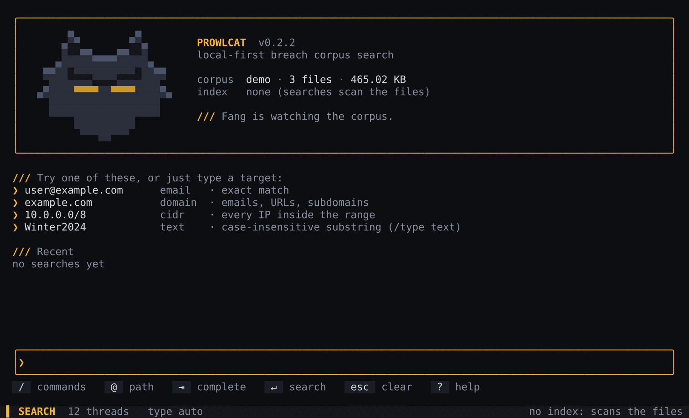
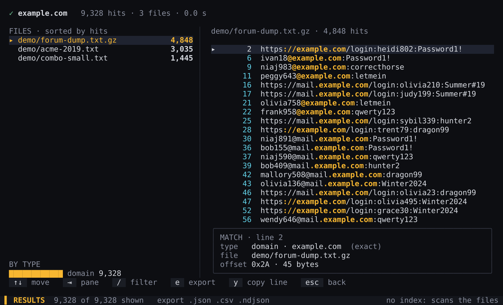
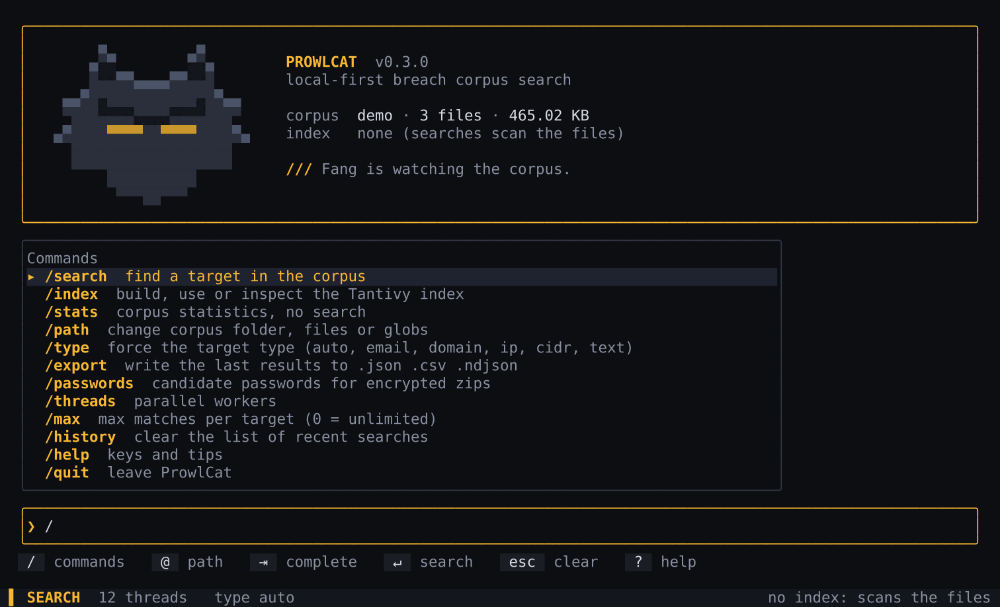
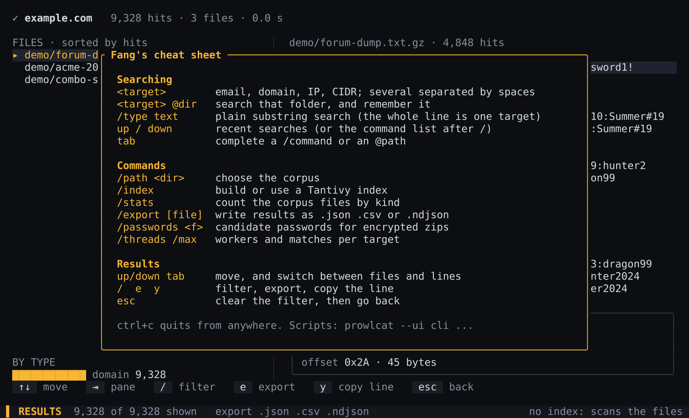

# ProwlCat

[](https://github.com/m0s-s/ProwlCat/actions/workflows/ci.yml)
[](https://github.com/m0s-s/ProwlCat/releases)
[](./LICENSE)

**A local-first search engine for breach corpora.** Point it at a folder of dumps (plain text, `.gz`, `.bz2`, `.xz`, `.zst`, `.zip`, `.7z`, `.rar`, `.tar` and its compressed forms, and SQLite, BSON and JSON-array dumps) and find emails, domains, IP addresses, CIDR ranges or plain text in seconds, with no server, no upload and no external API. Written in Rust.

<p align="center">
  
</p>

- **Two interfaces, one engine.** An interactive terminal UI for exploring, and a classic command line that never changes, for scripts and pipelines.
- **Built for big corpora.** Parallel scanning, streaming decompression, and memory that stays flat however many matches a search finds: results that do not fit in RAM wait on disk.
- **Every common container.** Reads inside archives without extracting them, including password-protected zips (with passwords you supply).
- **Optional index.** Build a [Tantivy](https://github.com/quickwit-oss/tantivy) index once, then repeat searches almost instantly.

> ProwlCat is a tool for security research, incident response and checking exposure of accounts you are authorised to look into. It searches data you already have on your own machine. Make sure you have the right to hold and search the data you point it at.

## Contents

- [Install](#install)
- [Quick start](#quick-start)
- [Interactive mode](#interactive-mode)
- [Command line](#command-line)
- [What gets matched](#what-gets-matched)
- [Output formats](#output-formats)
- [Large searches and memory](#large-searches-and-memory)
- [Indexing](#indexing)
- [Environment variables](#environment-variables)
- [Development](#development)

## Install

### Prebuilt binaries

Download the archive for your system from the [Releases](https://github.com/m0s-s/ProwlCat/releases) page. Each one has a `.sha256` file next to it.

| System | Archive |
|--------|---------|
| Linux x86-64 | `prowlcat-vX.Y.Z-x86_64-unknown-linux-gnu.tar.gz` |
| macOS Apple silicon | `prowlcat-vX.Y.Z-aarch64-apple-darwin.tar.gz` |
| macOS Intel | `prowlcat-vX.Y.Z-x86_64-apple-darwin.tar.gz` |
| Windows x86-64 | `prowlcat-vX.Y.Z-x86_64-pc-windows-msvc.zip` |

```bash
sha256sum -c prowlcat-vX.Y.Z-x86_64-unknown-linux-gnu.tar.gz.sha256
tar xzf prowlcat-vX.Y.Z-x86_64-unknown-linux-gnu.tar.gz
```

The macOS binaries are not signed or notarised. If macOS refuses to run one, clear the quarantine flag once with `xattr -d com.apple.quarantine prowlcat`, or right-click the file and choose Open.

### From source

You need a recent stable [Rust toolchain](https://rustup.rs).

```bash
cargo install --git https://github.com/m0s-s/ProwlCat prowlcat-cli

# or, from a checkout
cargo build --release          # binary: target/release/prowlcat
```

## Quick start

```bash
# Open the interactive interface (it remembers your corpus between runs)
prowlcat

# Or search straight from the command line
prowlcat search user@example.com -p /path/to/breaches -r
```

`-p` takes files, directories or globs, and `-r` descends into subdirectories.

## Interactive mode

Run `prowlcat` on its own in a terminal. Type a target (an email, a domain, an IP, a CIDR range) and press enter. **Fang**, the mascot, prowls while the scan runs, hits stream in live, and the results open in an explorer when it finishes.

```bash
prowlcat                               # open the interface
prowlcat tui acme.corp -p ~/breaches   # same, and start searching right away
```

<p align="center">
  
</p>

The explorer lists the files that matched, sorted by number of hits, and the matching lines of the selected file, with the matched part highlighted. A panel underneath shows where the line came from (file, line, byte offset).

### Commands

Type `/` at the prompt to see the commands. `up` and `down` move through the list, `tab` completes.

<p align="center">
  
</p>

| Command | Does |
|---------|------|
| `/search` | find a target in the corpus |
| `/path <dir>` | change the corpus: a folder, files or globs |
| `/index` | build, use or inspect a Tantivy index |
| `/stats` | count the corpus files by kind, without searching |
| `/type <kind>` | force the target type: `auto`, `email`, `domain`, `ip`, `cidr`, `text` |
| `/export [file]` | write the last results as `.json`, `.csv` or `.ndjson` |
| `/passwords <file>` | candidate passwords for encrypted zips |
| `/threads <n>` | number of parallel workers |
| `/max <n>` | maximum matches per target (`0` = unlimited) |
| `/history clear` | forget the recent searches |
| `/help` | keys and tips |
| `/quit` | leave |

Add `@dir` after a target to search that folder and remember it: `acme.corp @~/breaches/2023`.

### Keys

| Key | Where | Does |
|-----|-------|------|
| `/` then a name | home | commands |
| `@dir` after a target | home | search that folder, and remember it |
| `tab` | home | complete a `/command` or an `@path` |
| `up` / `down` | home | recent searches |
| `esc` | scan | stop the search |
| `up` / `down`, `tab` | results | move, switch between the file list and the lines |
| `/`, `e`, `y` | results | filter, export, copy the line |
| `?` | anywhere | cheat sheet |
| `ctrl+c` | anywhere | quit |

<p align="center">
  
</p>

### Look and feel

The interface uses the **Night Eyes** theme (amber on black). It adapts to the terminal: truecolor, 256 or 16 colours, `NO_COLOR`, and an ASCII-only mode for non-UTF-8 locales. A terminal that is too short swaps the mascot for a pair of eyes. `PROWLCAT_NO_ANIM=1` holds a still frame instead of animating Fang.

Pressing `esc` during a scan stops it: files not yet started are skipped and the file being read stops matching within a few hundred lines. A very large single file may still be read to its end in the background.

The interface remembers the last corpus path, index path and your recent targets in a small JSON file in the per-user state directory. Targets can be sensitive: turn it off with `--no-history` (or `PROWLCAT_NO_HISTORY=1`), or clear it with `/history clear`.

### Choosing the interface

The command line is the scripting interface and is untouched. The interactive UI only opens when you ask for it, or when you run `prowlcat` with nothing after it in a terminal.

| You run | In a terminal | Piped, redirected, in a script |
|---------|---------------|--------------------------------|
| `prowlcat` | interactive UI | usage error, as always |
| `prowlcat search …`, `index`, `stats` | classic, unchanged | classic, unchanged |
| `prowlcat tui [TARGET]… [-p DIR]` | interactive UI | error: needs a terminal |
| `prowlcat --ui cli …` or `PROWLCAT_UI=cli` | classic everywhere, even bare | classic |
| `prowlcat --ui tui search …` | interactive UI, prefilled from the options | error: needs a terminal |

`--ui` takes `auto` (default), `tui` or `cli`. Put `PROWLCAT_UI=cli` in a script's environment to guarantee the classic behaviour whatever its caller does. Exit codes, output formats and flags of `search`, `index` and `stats` are the same in every mode.

## Command line

```
prowlcat search [OPTIONS] [TARGET]...
prowlcat index  [OPTIONS] --path <PATH> --output <DIR>
prowlcat stats  [OPTIONS] --path <PATH>
prowlcat tui    [OPTIONS] [TARGET]...
prowlcat hashid [HASH]...
```

The options are the same wherever they appear, and `--help` groups them the same way (Input, Matching, Limits and speed, Output, Encrypted archives):

| Option | Meaning wherever it appears (`stats` takes only the first two) |
|--------|---------------------------------------------------------------|
| `-p, --path <PATH>` | what to read: files, directories or globs, repeatable |
| `-r, --recursive` / `--no-recursive` | descend into subdirectories (the default) or stay in the top level |
| `-j, --threads <N>` | parallel worker threads |
| `--password <PASSWORD>`, `--password-file <FILE>` | candidate passwords for encrypted zips |

Sizes (`--max-line-bytes`, `--snippet`) accept `K`, `M` and `G`. `-t/--type` and `--format` take a fixed set of values, shown by `--help` and checked before anything runs, in any case (`-t EMAIL` works).

### `prowlcat search`

Search for one or more targets. Several targets can be given on the command line or read from a file; each is searched in a single pass over the corpus.

| Option | Description |
|--------|-------------|
| `[TARGET]...` | targets: email, domain, IP, CIDR or plain text |
| `-f, --targets-file <FILE>` | file with one target per line |
| `-p, --path <PATH>` | files, directories or globs to scan (repeatable) |
| `-r, --recursive`, `--no-recursive` | descend into subdirectories (the default; `-r` is accepted for old scripts) or do not |
| `--index <DIR>` | search a prebuilt index instead of scanning (see [Indexing](#indexing)) |
| `-t, --type <TYPE>` | force the target type: `auto` (default), `email`, `domain`, `ip`, `cidr`, `text` |
| `--loose` | plain-text, case-insensitive substring search, no type inference |
| `-m, --max-matches <N>` | maximum matches per target (`0` = unlimited, the default) |
| `-j, --threads <N>` | parallel worker threads (default: all cores) |
| `--formats <MODE>` | `auto` (default) reads SQLite databases, BSON dumps and `.json` arrays record by record; `text` reads every file as the plain bytes it is. See [Databases and dumps](#databases-and-dumps) |
| `--max-line-bytes <SIZE>` | search lines longer than `SIZE` in overlapping pieces, so memory stays bounded however long a line is (`64K`, `1M`; at least `4K`; `0` = whole lines, the default). See [Very long lines](#very-long-lines) |
| `--snippet <SIZE>` | report only this many bytes of context on each side of a match in a long line, with `…` where it goes on (`0` = whole lines, the default) |
| `-o, --output <FILE>` | write the results to a file; the extension picks the format (`.json`, `.ndjson`, `.csv`). `-o -` writes to standard output, as NDJSON unless `--format` says otherwise |
| `--format <FORMAT>` | `table`, `json`, `ndjson` (or `jsonl`), `csv`. With `-o` it overrides the extension; **without `-o` the results go to standard output in that format**, which is what you want in a pipe |
| `--password <PASSWORD>` | password for encrypted zips (repeatable; visible in the process list, prefer the file) |
| `--password-file <FILE>` | file with one candidate password per line |
| `--no-progress` | no banner and no progress bar |
| `--extract` | print `account:secret` for each matching line instead of the whole line. See [Extracting accounts](#extracting-accounts-and-hiding-secrets) |
| `--unique` | with `--extract`: each account and secret once, sorted |
| `--mask` | hide secrets: what follows each match, or the secret with `--extract`, is shown as `***` |
| `-q, --quiet`, `-v, --verbose` | less or more logging |
| `--ui <auto\|tui\|cli>` | choose the interface (see above) |

Without `-o` or `--format` the results are printed as a readable table on standard output; `--format table -o FILE` writes that same table to a file. With `--format json|ndjson|csv` (or `-o -`) the output is only the data, with no banner in front, so it can be piped:

```bash
prowlcat search example.com -t domain -p ./data --format ndjson | jq -r .source.path | sort | uniq -c
```

### `prowlcat index`

Build a Tantivy index of a corpus. See [Indexing](#indexing).

| Option | Description |
|--------|-------------|
| `-p, --path <PATH>` | files, directories or globs to index |
| `-o, --output <DIR>` | directory to create the index in (must not exist or be empty) |
| `-r, --recursive`, `--no-recursive` | as for `search` |
| `-j, --threads <N>` | parallel worker threads |
| `--formats <MODE>` | as for `search`: `text` indexes SQLite, BSON and JSON-array files as plain bytes |
| `--password`, `--password-file` | as for `search` |

### `prowlcat stats`

Count what is in a corpus, by kind, without searching it. It takes `-p`, `-r/--no-recursive` and `--formats` (with `--formats text`, databases and dumps are counted as plain files), and, for `--check`, `--password` and `--password-file`.

```console
$ prowlcat stats -p ./breaches -r
ProwlCat stats
  files:      3
  plaintext:  2
  gzip:       1
  zstd:       0
  tar/tar.gz: 0
  zip:        0
  bzip2:      0
  xz:         0
  7z:         0
  rar:        0
  sqlite:     0
  bson:       0
  json array: 0
  total size: 0.00 GB
```

`bzip2`, `xz` and `zstd` count the files of that kind, tarballs included (`.tar.bz2`, `.tar.xz`, `.tar.zst`); `tar/tar.gz` counts `.tar` and `.tar.gz`.

`stats --check` also **opens every file, without searching it,** and says which ones a search could not read. It takes `--password` and `--password-file` like `search`:

```console
$ prowlcat stats -p ./breaches --check --password-file passwords.txt
…
Readability (every file is opened and its start read; nothing is searched)
  can be read:           412 of 415
  need a password:       2
  need a RAR program:    0
  cannot be read:        1

Need a password (--password or --password-file):
  ./breaches/clients-2021.zip
  ./breaches/old.7z

Cannot be read (damaged, or a format that is not what its name says):
  ./breaches/part3.txt.gz: invalid gzip header
```

It reads the start of each file, so damage further inside a file is not found. The exit code is 0 either way.

### Examples

```bash
# Email
prowlcat search user@example.com -p ./breaches -r

# Several targets at once, one pass over the data
prowlcat search alice@example.com bob@example.com -p ./breaches -r

# Domain: emails, URLs and subdomains
prowlcat search example.com -t domain -p ./data

# IP and CIDR
prowlcat search 203.0.113.42 -t ip -p ./logs
prowlcat search 10.0.0.0/8 -t cidr -p ./logs

# Plain text (case-insensitive substring)
prowlcat search Winter2024 -t text -p ./breaches
prowlcat search "john.smith" --loose -p ./breaches

# Targets from a file, results to JSON
prowlcat search -f targets.txt -p ./dumps -o results.json

# Encrypted zips: supply candidate passwords (ProwlCat tries them, it does not crack)
prowlcat search user@example.com -p ./dumps --password-file passwords.txt

# Stop after the first 100 matches per target
prowlcat search example.com -p ./data -m 100
```

In a script, pin the classic behaviour and read the exit code:

```bash
export PROWLCAT_UI=cli
prowlcat search user@example.com -p ./breaches -r --no-progress -o hits.ndjson
case $? in
  0) echo "found" ;;
  1) echo "no matches" ;;
  *) echo "error" >&2 ;;
esac

# Count the matches per file with jq
jq -r '.source.path' hits.ndjson | sort | uniq -c | sort -rn
```

### Exit codes

| Command | `0` | `1` | `2` |
|---------|-----|-----|-----|
| `search` | matches found (with `--extract`: records written) | no matches (or no records) | error |
| `hashid` | every hash identified | at least one unknown | error |
| `index`, `stats` | done | | error |

A file that could not be read does not make `search` fail by itself: it is counted (`warnings: N files failed`) and the exit code says only whether something matched. `stats --check` is how to find those files beforehand.

## What gets matched

| Type | Flag | Behaviour |
|------|------|-----------|
| auto | `-t auto` (default) | infers email, IP, CIDR or domain from the target |
| email | `-t email` | the address, as a whole token |
| domain | `-t domain` | the domain in emails, URLs and subdomains (see below) |
| ip | `-t ip` | a single IPv4 or IPv6 address, as a whole token |
| cidr | `-t cidr` | the literal CIDR string, and every IP address inside the network |
| text | `-t text` or `--loose` | case-insensitive substring, no type rules |

**SQL dumps** are plain text, so they are searched like any other file (`INSERT … VALUES (…),(…)`, `COPY` blocks, `.sql.gz`). ProwlCat does not parse SQL: a match is a match in the text, and it does not know which column it is in. Dumps often put thousands of rows on one line; see [Very long lines](#very-long-lines).

**Domain search** finds `example.com` in:

- email addresses: `user@example.com`
- subdomains: `b@mail.example.com`, `mail.example.com`
- URLs: `https://example.com/login`, `https://shop.example.com/`

It does not match longer names such as `example.community` or `notexample.com`.

**Containers.** ProwlCat detects the format from the file and reads inside it without extracting to disk:

| Format | Notes |
|--------|-------|
| plain text | large files are memory-mapped |
| `.gz`, `.bz2`, `.xz`, `.zst` | streamed; files made of several streams (`pbzip2`, `cat a.xz b.xz`) are read to the end |
| `.tar`, `.tar.gz`, `.tar.bz2` (`.tbz2`), `.tar.xz` (`.txz`), `.tar.zst` | each entry is scanned; matches show the entry name |
| `.zip`, `.7z` | each member is scanned; encrypted archives are opened with the passwords you provide (`--password`, `--password-file`), tried in order |
| `.rar` | each member is scanned, through **7-Zip** run as a separate program (see below); needs `7zz` or `7z` installed |

The format is recognised from the name and, for a file with another name (`dump.bin`), from its first bytes (gzip, bzip2, xz, zstd, zip, 7z). A `.7z`, `.zip` or `.rar` that cannot be opened (missing or wrong password, damage, no program for RAR) counts as a failed file: the table says `warnings: N files failed` and the log names it.

### Databases and dumps

Three kinds of file that are not text are read natively, record by record. Each record becomes one line, so matching, results, `--extract` and the output formats work as for any file:

| Source | One line is | The result shows |
|--------|-------------|------------------|
| SQLite database (recognised by its first bytes, whatever the name) | a row: its values separated by tabs, a blob as hex, `NULL` as nothing, a newline inside a value as a blank | the table as the entry, the row number (from 0) as the line |
| MongoDB dump (`.bson`) | a document, as relaxed extended JSON | the document number as the line |
| `.json` file that is one array | an element, as compact JSON | the element number as the line |

Rows, documents and elements are read one at a time, so memory does not depend on the size of the source. Notes:

- The database is opened read-only. A SQLite database that is encrypted (SQLCipher) or damaged is a failed file, and `stats --check` names it. One inside an archive is not read as a database (it needs a file of its own); extract it first.
- A `.json` file that is an object, or one line per record (`.ndjson`, `.jsonl`), is plain text and is searched as such.
- `--extract` expects the account first. A SQLite row whose first column is the email gives `email:` followed by the other columns, tab-separated, as the secret.
- `--formats text` (or `PROWLCAT_FORMATS=text`) turns all of this off and searches the plain bytes, which is what a damaged file may need.

**RAR archives.** ProwlCat contains no RAR decoder, so it does not carry that code or its license terms. For `.rar` it runs 7-Zip, installed by you, as a separate program: it lists the archive, then reads every member in one pass and cuts the stream at the listed sizes, so members keep their names and nothing is written to disk. It looks for `7zz` and then `7z` in `PATH`; `PROWLCAT_RAR_TOOL=/path/to/7zz` picks one. Install it with your package manager (`pacman -S 7zip`, `apt install 7zip`, `brew install sevenzip`). Without it, a `.rar` is reported as a failed file and `stats --check` says so. A password goes to 7-Zip on its command line, where other users of the machine can see it for as long as it runs, as with `--password` itself.

Matches are always reported in a stable order: by target, then file path, then line number.

## Output formats

The default is a readable table (line numbers start at 1 here):

```console
$ prowlcat search ivan18@example.com mallory508@mail.example.com -p ./demo -r --no-progress
ProwlCat | 2 targets | 3 files | 0.00 GB scanned | 2 matches | 0.0s

[email] ivan18@example.com
  └─ demo/forum-dump.txt.gz:6
     ivan18@example.com:Password1!

[email] mallory508@mail.example.com
  └─ demo/forum-dump.txt.gz:42
     mallory508@mail.example.com:dragon99
```

A CIDR search reports each address found inside the range:

```console
$ prowlcat search 198.51.100.0/24 -t cidr -p ./demo -r --no-progress
[cidr] 198.51.100.0/24 [IpInNetwork: Ip("198.51.100.108")]
  └─ demo/acme-2019.txt:4
     198.51.100.108 admin hunter2
```

With `-o`, results go to a file. Every format writes one result at a time, so memory does not grow with the number of matches.

| Extension | Format |
|-----------|--------|
| `.json` | one compact JSON document on a single line: `{"results": [...], "summary": {...}}`. Pipe it through `jq .` to read it |
| `.ndjson`, `.jsonl` | one JSON object per match, one per line |
| `.csv` | a header row, then one row per match |

In the JSON, NDJSON and CSV files `line_number` and `line` count from 0; the table counts from 1.

NDJSON (one match per line, shown wrapped here):

```json
{"query":"ivan18@example.com","kind":"email","match_kind":"exact",
 "source":{"path":"demo/forum-dump.txt.gz","archive_entry":null,"line_number":5,"byte_offset":177},
 "line_text":"ivan18@example.com:Password1!","matched_span":[0,18],
 "extracted":[{"email":"ivan18@example.com"}]}
```

CSV:

```csv
query,kind,match_kind,path,line,byte_offset,context
ivan18@example.com,Email,Exact,demo/forum-dump.txt.gz,5,177,ivan18@example.com:Password1!
```

## Extracting accounts and hiding secrets

Search results are whole lines. For breach lists you often want only the pairs, once each, or want to share results without the passwords. Three options do it; none changes which lines match.

**`--extract`** prints `account:secret` for each matching line:

```console
$ prowlcat search example.com -t domain -p ./breaches --extract
alice@example.com:Password1!
bob@mail.example.com:5f4dcc3b5aa765d61d8327deb882cf99
```

It expects the layout of combo lists, **the account first, then a separator (`:` `;` `,` `|` tab or blank), then the secret**; the secret may itself contain separators. A line laid out differently is not guessed at: it is skipped and counted (`… (2 skipped: not laid out as account then secret)`, on standard error). That covers URL records (`https://site/login:user:pass`), lines with the password first (`password:email`) and SQL rows. The account is the email address around the match, so a domain search gives full addresses.

The output goes to standard output with no banner, or to `-o FILE`: `.json`, `.ndjson` and `.csv` give fields, any other extension gives the plain lines (and so does `--format table`). The fields are `account`, `secret`, `secret_looks_like`, `query`, `path`, `archive_entry` and `line`. `secret_looks_like` lists what the secret can be when it has the form of a password hash (see `hashid` below), and is empty for a plain password.

**`--unique`** (with `--extract`) writes each account and secret once, sorted by account then secret. Accounts are compared ignoring case (`ALICE@x.io` and `alice@x.io` are one), secrets exactly; the first occurrence found is the one kept. It works for any number of records: they are sorted in temporary files, in the same place and the same way as the results of a large search (see [Large searches and memory](#large-searches-and-memory)).

**`--mask`** hides secrets. With `--extract` the secret is written as `***` (and `secret_looks_like` still says what it was). Without it, every result keeps its line up to the match and the separator after it, then `***`: `alice@example.com:***`. This is made for `account:secret` lines; **a line that keeps the password before the account is not protected**, and a match is not a guarantee that nothing sensitive is left elsewhere on the line. Check what you share.

```bash
# Every pair once, passwords hidden, as CSV, ready to hand over
prowlcat search example.com -t domain -p ./breaches --extract --unique --mask -o exposed.csv
```

## Identifying hashes

`prowlcat hashid` says what kind of password hash a string looks like. It identifies; it does not decrypt or crack anything.

```console
$ prowlcat hashid 5f4dcc3b5aa765d61d8327deb882cf99 '$2y$10$…' hunter2
5f4dcc3b5aa765d61d8327deb882cf99	MD5, NTLM, MD4, LM, md5(md5(password))
$2y$10$…	bcrypt
hunter2	unknown
```

Formats with a prefix (`$2y$`, `$6$`, `$P$`, `{SSHA}`, `pbkdf2_sha256$`, a MySQL `*`…) give one answer. A bare hex digest says only its length, so the answer is a list, likeliest first: nothing in 32 hex digits tells an MD5 from an NTLM hash. With no arguments it reads one hash per line from standard input; the exit code is 1 if any could not be identified.

## Large searches and memory

A search over a big breach can match hundreds of millions of lines. ProwlCat keeps memory flat:

- Matches are held in a compact form, up to a budget of **256 MiB** of RAM (`PROWLCAT_RESULT_MEM_MB`).
- Past the budget they are sorted and written to temporary files on disk, then merged back in the usual order. The size of the result set is limited by free disk space, not by memory.
- Results and their order are the same whatever the budget; it only trades memory for speed.

**Where the temporary files go.** They must not land in RAM. If the system temporary directory is a `tmpfs` (the default `/tmp` on several Linux distributions), ProwlCat uses `/var/tmp` or `~/.cache/prowlcat` instead and logs a warning. To choose the location yourself, for example a big disk:

```bash
PROWLCAT_TMP_DIR=/mnt/big-disk/tmp prowlcat
```

A very large search can write many gigabytes there while it runs; the files are removed when it ends. Keep an eye on free space with `df -h`.

**In the interactive interface** the results screen shows the first 250,000 matches. A search that finds more still counts all of them, and `/export` writes the complete set.

### Very long lines

Some dumps are one gigantic line: a `mysqldump` `INSERT` with every row of a table, a minified export. By default a line is read whole and reported whole, which is right for normal files but can need several times the line's size in memory, and prints the entire line for every match. Two options, both off by default, deal with it:

| Option | Does |
|--------|------|
| `--max-line-bytes SIZE` | bounds **memory**: a longer line is searched in pieces of at most `SIZE` bytes |
| `--snippet BYTES` | bounds the **output**: a match is shown with `BYTES` of context on each side, not the whole line |

For a huge line use both:

```bash
prowlcat search example.com -t domain -p ./dumps --max-line-bytes 1M --snippet 60
```

```json
{"query":"needle@example.com", ... "line_number":0,"byte_offset":100978876},
 "line_text":"…er.test','pw'),('u@filler.test','pw'),('needle@example.com','pw'),('u@filler.test','pw'),('u@fille…",
 "matched_span":[43,64], ...}
```

How it works, and what to expect:

- Pieces are cut at separators (space, tab, `,` `;` `(` `)` quotes, `|`), which never occur inside an email, host name or IP address, and each piece repeats up to 256 bytes of the previous one so a match across a cut is found whole. In tests the same matches are found with and without a cap, from 4 KiB up. A match longer than 256 bytes that straddles a cut can be missed (a very long plain-text target, for instance).
- A match is reported with the line number of its line, the byte offset of its **piece**, and, without `--snippet`, the piece as `line_text`. `matched_span` always points inside `line_text`.
- With `--snippet`, a line that fits in the window is shown unchanged. `…` marks each side where the line goes on, and is counted in `matched_span`.
- `--snippet` alone shortens the output but still reads the line whole; `--max-line-bytes` is what keeps memory flat. On a 381 MB single-line file, a 700 MB memory limit kills a normal search and lets `--max-line-bytes 64K` finish.
- In the interactive interface, set `PROWLCAT_MAX_LINE_BYTES` and `PROWLCAT_SNIPPET` before starting it.

**`--max-matches`** limits matches per target within each file. It is the quickest way to bound a search whose first results are enough.

## Indexing

For a corpus you search again and again, build an index once and search it instead of scanning the files:

```bash
prowlcat index -p ./breaches -r -o ./breaches.idx
prowlcat search user@example.com --index ./breaches.idx
prowlcat search example.com -t domain --index ./breaches.idx
```

The index covers emails, domains and IP addresses (including CIDR ranges). Plain-text and `--loose` targets are not supported with an index; scan the files for those. The index records where each match is, so results are the same as a scan would give. `/index` in the interactive interface builds, selects or inspects one.

## Environment variables

| Variable | Effect |
|----------|--------|
| `PROWLCAT_UI` | `auto`, `tui` or `cli`; same as `--ui` |
| `PROWLCAT_NO_ANIM=1` | hold a still frame instead of animating Fang (also `prowlcat tui --no-animation`) |
| `PROWLCAT_NO_HISTORY=1` | do not remember the corpus or recent searches (also `--no-history`) |
| `PROWLCAT_STATE_DIR` | where that memory is kept (default: the per-user state directory) |
| `PROWLCAT_COLOR` | `truecolor`, `256`, `16` or `none`; overrides detection |
| `NO_COLOR` | no colours at all |
| `PROWLCAT_ASCII=1` | plain ASCII glyphs and mascot |
| `PROWLCAT_RESULT_MEM_MB` | RAM used to hold matches before they are parked in temporary files (default 256); affects memory and speed, never the results |
| `PROWLCAT_TMP_DIR` | directory for those temporary files; by default the system temp directory, or `/var/tmp` / `~/.cache/prowlcat` when that is a RAM-backed `tmpfs` |
| `PROWLCAT_MAX_LINE_BYTES` | default for `--max-line-bytes` (also used by the interactive interface) |
| `PROWLCAT_SNIPPET` | default for `--snippet` (also used by the interactive interface) |
| `PROWLCAT_FORMATS` | `text` reads databases and dumps as plain bytes (same as `--formats text`) |
| `PROWLCAT_RAR_TOOL` | path of the program (`7zz`, `7z`) that reads `.rar` archives, instead of looking in `PATH` |
| `PROWLCAT_LOG_FILE` | write log lines to this file while the interface is open (they would otherwise draw over it) |

## Development

```bash
cargo build --workspace --locked
cargo test --workspace
cargo clippy --workspace --all-targets -- -D warnings      # CI requires this
cargo bench -p prowlcat-core --bench scan                  # PROWLCAT_BENCH_MB sets the corpus size
```

The workspace is split into small crates: `prowlcat-source` (file enumeration), `prowlcat-decode` (line readers for every container), `prowlcat-match` (the matching engine), `prowlcat-core` (the parallel scan and the bounded result store), `prowlcat-output` (streaming writers), `prowlcat-index` (Tantivy), `prowlcat-tui` (the interface) and `prowlcat-cli` (the `prowlcat` binary). [ARCHITECTURE.md](./ARCHITECTURE.md) explains how they fit together. Changes are listed in [CHANGELOG.md](./CHANGELOG.md).

### Tests and releases

`cargo test --workspace` includes an end-to-end suite (`crates/prowlcat-cli/tests/e2e.rs`) that runs the real binary on a generated corpus: every container, every target type, every output format, exit codes, an index against a scan, the memory budget and spill directory, and a golden digest of a fixed corpus. `PROWLCAT_E2E_BIN` points it at another binary, which is how the release workflow tests the packaged one.

The screenshots in this README are regenerated for every release, by running the real interface on a made-up corpus: after bumping the version, `cargo build --release -p prowlcat-cli && scripts/screenshots.sh` (needs `rsvg-convert`; look at the images before committing them). The release gate refuses a version whose screenshots are older.

Before tagging a release, run the full gate and fix whatever it reports:

```bash
scripts/release-check.sh 0.3.0     # version, change log, screenshots, lockfile, tests, clippy, e2e on the release build, licenses
```

Pushing a `v*` tag then runs the tests on Linux, macOS and Windows, builds the four packages, runs the end-to-end suite on each packaged binary, and publishes the release only if all of that passed. The dependency licenses are checked against `deny.toml` (the project is AGPL-3.0-or-later); `scripts/gen-third-party.sh` regenerates `THIRD-PARTY-NOTICES.md`, which ships with every package.

## License

GNU Affero General Public License v3.0 or later. See [LICENSE](./LICENSE).
